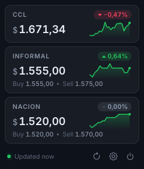
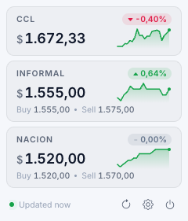
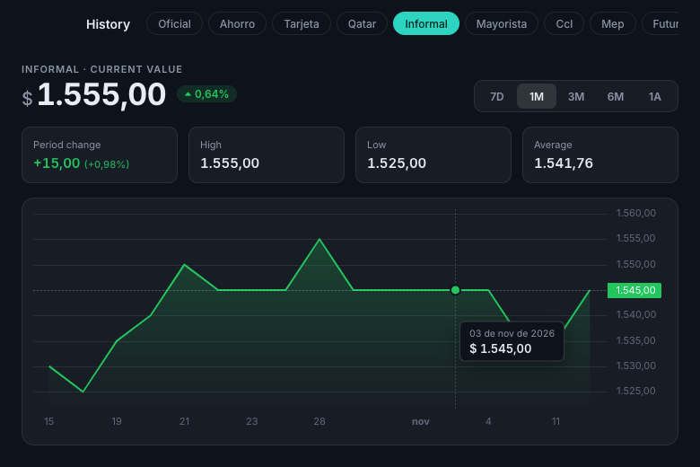
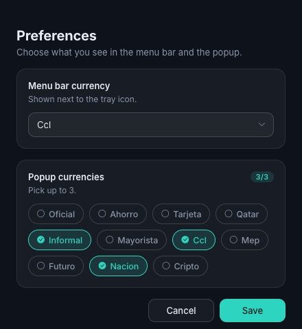

# About

Currency Exchange Tray info app, powered by Angular 15 with Electron 22 (Typescript + SASS + Hot Reload).


## Features

- Dollar quotes (Ámbito) plus BYMA stocks, CEDEARs, bonds and crypto, searchable and addable from Preferences.
- Tray popup with one tab per category and up to 5 quotes each: animated price changes, daily variation, buy/sell spread and a 30-day sparkline.
- History window (click any card): area chart powered by [lightweight-charts](https://github.com/tradingview/lightweight-charts) with 7D / 1M / 3M / 6M / 1A ranges, period change, high, low and average.
- Light and dark themes that follow the OS, native vibrancy on macOS, bundled Inter font (works offline).
- English and Spanish translations (picked from the system language).

## Screenshots

Main tray window (dark and light themes)

 

History



Preferences



## Quotations configuration

Quotations are defined in `app/config/cu-exchange-properties.json`. Market instruments are usually added from Preferences, which searches each provider's catalog, but they can also be edited by hand. Each entry has:

| Field      | Description                                                                 |
|------------|-----------------------------------------------------------------------------|
| `name`     | Unique id shown in the UI and used by `defaultCurrency` / `showCurrencies`  |
| `category` | `dolar`, `acciones`, `cedears`, `bonos` or `cripto`                         |
| `source`   | `ambito`, `data912` or `binance`                                            |
| `symbol`   | Ticker for data912 / Binance (e.g. `GGAL`, `AL30D`, `BTCUSDT`). Defaults to `name` |
| `fetchURL` | Ámbito only: the `/variacion` endpoint                                      |

Entries without `category` / `source` are treated as Ámbito dollars, so older config files keep working.

Data sources (all free, no API key):

- **[Ámbito](https://www.ambito.com/contenidos/dolar.html)**, for dollar quotes. History is derived from `fetchURL` by replacing `/variacion` with `/historico-general/{from}/{to}`. For endpoints that don't follow that pattern, add an optional `historyURL` with `{from}` and `{to}` placeholders (dates as `yyyy-mm-dd`). Currencies without history (e.g. `futuro`) simply hide the chart.
- **[data912](https://data912.com)**, for BYMA stocks (`/live/arg_stocks`), CEDEARs (`/live/arg_cedears`) and bonds (`/live/arg_bonds`), with daily history from `/historical/{stocks|cedears|bonds}/{ticker}`. Each category is a single request cached for 30 seconds. CEDEAR and bond tickers ending in `D` (MEP) or `C` (CCL) are shown in US$.
- **[Binance public API](https://developers.binance.com/docs/binance-spot-api-docs/rest-api)**, for crypto against USDT (`/api/v3/ticker/24hr`, with history from `/api/v3/klines`).

If one provider fails, the others keep updating; the popup only shows an error when every provider fails.

__Warning__
Known issues on Linux env:
  - Tray window opens in wrong position.
  - Tray component does not support text information (just tray icon).
  - Preferences are not being saved.   

__Warning__ Not tested on Win env yet!

## Getting Started

*Clone this repository locally:*

``` bash
git clone https://github.com/fedecarpi/cu-exchange.git
```

*Install dependencies with npm (used by Electron renderer process):*

``` bash
npm install
```

There is an issue with `yarn` and `node_modules` when the application is built by the packager. Please use `npm` as dependencies manager.

If you want to generate Angular components with Angular-cli , you **MUST** install `@angular/cli` in npm global context.
Please follow [Angular-cli documentation](https://github.com/angular/angular-cli) if you had installed a previous version of `angular-cli`.

``` bash
npm install -g @angular/cli
```

*Install NodeJS dependencies with npm (used by Electron main process):*

``` bash
cd app/
npm install
```

Why two package.json ? This project follow [Electron Builder two package.json structure](https://www.electron.build/tutorials/two-package-structure) in order to optimize final bundle and be still able to use Angular `ng add` feature.

## To build for development

- **in a terminal window** -> npm start

Voila! You can use your Angular + Electron app in a local development environment with hot reload!

The application code is managed by `app/main.ts`. In this sample, the app runs with a simple Angular App (http://localhost:4200), and an Electron window. \
The Angular component contains an example of Electron and NodeJS native lib import. \
You can disable "Developer Tools" by commenting `win.webContents.openDevTools();` in `app/main.ts`.

## Project structure

| Folder | Description                                      |
|--------|--------------------------------------------------|
| app    | Electron main process folder (NodeJS)            |
| src    | Electron renderer process folder (Web / Angular) |

## How to import 3rd party libraries

This sample project runs in both modes (web and electron). To make this work, **you have to import your dependencies the right way**. \

There are two kind of 3rd party libraries :
- NodeJS's one - Uses NodeJS core module (crypto, fs, util...)
    - I suggest you add this kind of 3rd party library in `dependencies` of both `app/package.json` and `package.json (root folder)` in order to make it work in both Electron's Main process (app folder) and Electron's Renderer process (src folder).

Please check `providers/electron.service.ts` to watch how conditional import of libraries has to be done when using NodeJS / 3rd party libraries in renderer context (i.e. Angular).

- Web's one (like bootstrap, material, tailwind...)
    - It have to be added in `dependencies` of `package.json  (root folder)`

## Add a dependency with ng-add

You may encounter some difficulties with `ng-add` because this project doesn't use the defaults `@angular-builders`. \
For example you can find [here](HOW_TO.md) how to install Angular-Material with `ng-add`.

## Browser mode

Maybe you only want to execute the application in the browser with hot reload? Just run `npm run ng:serve:web`.

## Included Commands

| Command                  | Description                                                                                           |
|--------------------------|-------------------------------------------------------------------------------------------------------|
| `npm run ng:serve`       | Execute the app in the web browser (DEV mode)                                                         |
| `npm run web:build`      | Build the app that can be used directly in the web browser. Your built files are in the /dist folder. |
| `npm run electron:local` | Builds your application and start electron locally                                                    |
| `npm run electron:build` | Builds your application and creates an app consumable based on your operating system                  |
| `npm run release --release=X.Y.Z` | Triggers GitHub Actions to build Linux/macOS/Windows and publish a GitHub Release           |

**Your application is optimised. Only /dist folder and NodeJS dependencies are included in the final bundle.**

## Releasing

Publish installers for Linux (`.deb`), macOS (`.dmg`) and Windows (portable `.exe`) via a manual GitHub Actions workflow:

```bash
# requires GitHub CLI (gh) authenticated against this repo
npm run release --release=1.1.0

# or directly:
gh workflow run release.yml -f version=1.1.0

# pre-release:
gh workflow run release.yml -f version=1.1.0-beta.1 -f prerelease=true
```

You can also run it from GitHub → Actions → Release → Run workflow. Builds are unsigned (Gatekeeper / SmartScreen may warn).

## You want to use a specific lib (like rxjs) in electron main thread ?

YES! You can do it! Just by importing your library in npm dependencies section of `app/package.json` with `npm install --save XXXXX`. \
It will be loaded by electron during build phase and added to your final bundle. \
Then use your library by importing it in `app/main.ts` file. Quite simple, isn't it?

## E2E Testing

E2E Test scripts can be found in `e2e` folder.

| Command       | Description               |
|---------------|---------------------------|
| `npm run e2e` | Execute end to end tests  |

Note: To make it work behind a proxy, you can add this proxy exception in your terminal  
`export {no_proxy,NO_PROXY}="127.0.0.1,localhost"`

## Debug with VsCode

[VsCode](https://code.visualstudio.com/) debug configuration is available! In order to use it, you need the extension [Debugger for Chrome](https://marketplace.visualstudio.com/items?itemName=msjsdiag.debugger-for-chrome).

Then set some breakpoints in your application's source code.

Finally from VsCode press **Ctrl+Shift+D** and select **Application Debug** and press **F5**.

Please note that Hot reload is only available in Renderer process.

## Want to use Angular Material ? Ngx-Bootstrap ?

Please refer to [HOW_TO file](./HOW_TO.md)
